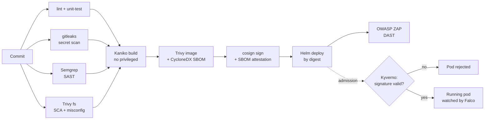

# catalog-api — a secure-by-default OTT catalog service

[](LICENSE)


A small FastAPI service (the content catalog of an OTT/streaming platform) used as the
workload for **[SecureStream](https://github.com/onurcarkcioglu/securestream-infra)** —
an end-to-end DevSecOps lab built on a single Proxmox server.

The application is intentionally simple. **The point of this repository is the delivery
chain around it:** every commit passes ten pipeline stages, the image is signed and carries
an SBOM attestation, and the Kubernetes cluster refuses to run anything the pipeline did not sign.

> The source of truth is a self-hosted GitLab; this GitHub repository is a read-only mirror
> of the protected `main` branch.

---

## Delivery chain



| # | Stage | Tool | Blocks the pipeline on |
|---|---|---|---|
| 1 | lint | ruff (incl. bandit `S` rules) | style errors, `shell=True`, hard-coded secrets |
| 2 | unit-test | pytest | broken behaviour, missing security headers, input validation |
| 3 | secret-scan | gitleaks | any secret in the commit history |
| 4 | sast | Semgrep (`p/python`, `p/owasp-top-ten`) | blocking code findings |
| 5 | sca | Trivy fs | HIGH/CRITICAL fixable CVEs, Dockerfile & Helm misconfig |
| 6 | build | Kaniko (maintained community fork) | — builds without a privileged runner |
| 7 | image-scan | Trivy image + CycloneDX SBOM | HIGH/CRITICAL fixable CVEs in the image |
| 8 | sign | cosign | — signs the image and attests the SBOM (`main` only) |
| 9 | deploy | Helm, image **by digest**, `--atomic` | failed rollout (auto-rollback) |
| 10 | dast | OWASP ZAP API scan | XSS, SQLi, command/code injection (rules in `zap-rules.tsv`) |

Stages 3–5 run in parallel (`needs: []`) so security feedback does not wait for tests.

## Security controls in this repository

**Supply chain**
- Every CI tool image is pinned **by digest**, not tag (`scripts/pin-images.sh`). Motivation:
  the March 2026 Trivy supply-chain compromise (CVE-2026-33634), where malicious releases were
  published under legitimate tags; digest-pinned pipelines were not affected.
- New tool versions wait roughly two weeks before adoption (cool-down period).
- Images are signed with cosign; the SBOM is attached as a signed in-toto attestation.
  The public key is in [`cosign.pub`](cosign.pub).
- Signing keys and the deploy kubeconfig are **protected, masked and hidden** CI variables:
  they exist only for pipelines on the protected `main` branch.

**Container & Kubernetes**
- Multi-stage build, slim base image passed in by digest, non-root `USER 10001`, `HEALTHCHECK`.
- Helm chart ([`deploy/helm/catalog-api`](deploy/helm/catalog-api)): read-only root filesystem,
  all capabilities dropped, `allowPrivilegeEscalation: false`, seccomp `RuntimeDefault`,
  no service-account token mounted, resource limits.
- `NetworkPolicy`: only the ingress controller may reach the pod; the pod has **no egress at all**.
- The namespace enforces Pod Security `restricted`; the deploy identity is a namespace-scoped
  Role (it cannot read secrets in other namespaces or list nodes).

**Application**
- Swagger/ReDoc disabled in production; `openapi.json` kept for the DAST scanner.
- Strict input validation (`kind` is an allow-list; a `<script>` payload returns 422, covered by a test).
- Security headers on every response (CSP, HSTS, `X-Content-Type-Options`, CORP, …) and no
  `Server` header — added after ZAP reported them, and locked in by a unit test.
- `/v1/admin/stats` is protected by an API key that exists only in HashiCorp Vault. External
  Secrets Operator logs in to Vault with a short-lived, audience-bound Kubernetes token (no static
  credential), and the key is compared with `secrets.compare_digest`.

## Evidence: the gates were tested by breaking them

A throw-away branch deliberately introduced a fake token, `subprocess.run(..., shell=True)`
and `requests==2.19.1`. Result: **lint, secret-scan, sast and sca all failed** — gitleaks
reported the token as `REDACTED`, Trivy reported CVE-2018-18074.

The test also exposed a real weakness: lint and unit tests initially failed during
`pip install` (dependency conflict) and **never read the code**. Lint now installs only a pinned
`ruff`, and a rerun showed ruff catching `S602` on its own. A red pipeline is only useful if it
is red for the right reason.

DAST: the first ZAP scan raised 3 warnings (missing `X-Content-Type-Options`, HSTS, CORP).
After the fix: **0 warnings, 120 passed checks**.

## Run locally

```bash
python3 -m venv .venv && . .venv/bin/activate
pip install -r requirements-dev.txt
ruff check . && pytest -q
uvicorn app.main:app --reload --port 8080
curl -s localhost:8080/v1/titles | python3 -m json.tool
```

Verify a published image signature (requires access to the registry):

```bash
cosign verify --key cosign.pub --insecure-ignore-tlog=true <registry>/securestream/catalog-api@sha256:<digest>
```

`--insecure-ignore-tlog` is used because signatures are deliberately **not** uploaded to the
public Rekor transparency log: the lab registry is private.

## Repository layout

```
app/                     FastAPI application
tests/                   pytest suite (behaviour + security requirements)
deploy/helm/catalog-api  hardened Helm chart
scripts/pin-images.sh    resolves CI tool images to digests
.gitlab-ci.yml           the 10-stage pipeline
zap-rules.tsv            ZAP rules that fail the pipeline
cosign.pub               image-signing public key
```

## Related

- **[securestream-infra](https://github.com/onurcarkcioglu/securestream-infra)** — the platform:
  Proxmox + Terraform, Ansible hardening, private CA, k3s, GitLab + Runner, Vault,
  Kyverno, Falco.

## License

[MIT](LICENSE)
